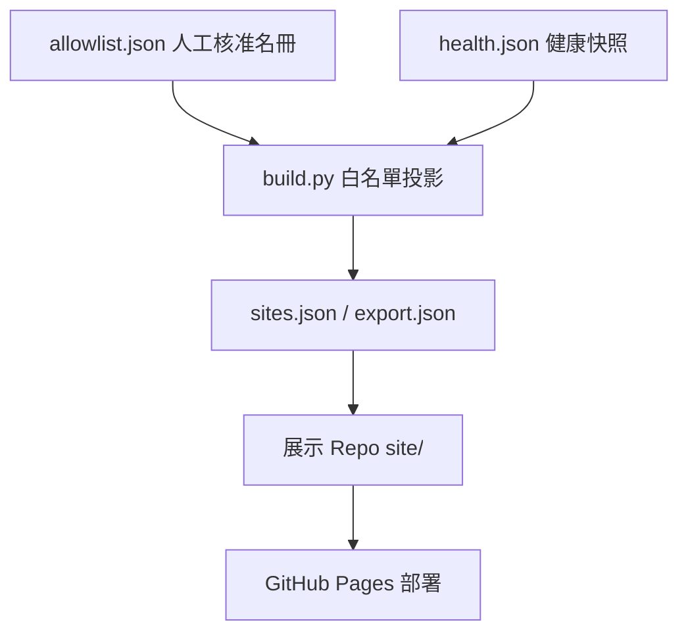

# Aris 網站書架：公開網頁如何被核准、彙整與發布 {#overview}

## 讀者與問題

讀者是想知道「這個網站書架收了哪些頁面、為什麼這些頁面能公開、改動後如何上線」的 Aris 與協作 Agent。不包含各頁面本身的研究內容，也不包含私人候選清單。

## 核心說明

網站書架只有一份人工核准名冊：`50_github_learn` 的 `site-directory/allowlist.json`。建置腳本把名冊與最近一次健康檢查合併，輸出白名單欄位的公開快照 `sites.json` 與 `export.json`，再複製到展示 Repo `arislee1979-afk.github.io` 的 `site/`。展示 Repo 合併到 main 後，GitHub Actions 只部署 `site/`（C1、C2、C3）。

名冊目前有 74 個已核准網頁、8 個分類，每個標題只保留一個網址；最近一次檢查 74 個為 LIVE、0 個為 404（C4、C6）。健康狀態只是快照，不代表之後仍可開啟（C5）。

Archify 互動架構圖：[發布架構圖](https://arislee1979-afk.github.io/architecture/)（typed JSON：`site-directory/archify/portal.architecture.json`）。

## 來源

| ID | 路徑／URL | 版本／查閱日期 | 適用範圍 |
| --- | --- | --- | --- |
| S1 | 50_github_learn `site-directory/allowlist.json` | main，2026-10-25 | 名冊與核准欄位 |
| S2 | 50_github_learn `site-directory/README.md` | main，2026-10-25 | 建置、驗證、發布規則 |
| S3 | arislee1979-afk.github.io `README.md`、`.github/workflows/pages.yml` | main，2026-10-25 | 展示層與部署 |
| S4 | 50_github_learn `site-directory/health.json` | main，2026-10-25 | 健康檢查快照 |

## 主張與未知 {#evidence}

| ID | 主張 | 狀態 | 依據 |
| --- | --- | --- | --- |
| C1 | `allowlist.json` 是唯一人工核准名冊，展示 Repo 沒有第二份可編輯名冊 | FACT | S1、S2、S3 |
| C2 | 公開快照只輸出白名單欄位，不匯出私人候選與 approval_basis | FACT | S2 |
| C3 | 展示 Repo main push 後 Actions 只部署 `site/`，並以工作分支與 PR 合併 | FACT | S2、S3 |
| C4 | 目前 74 個核准網頁、8 個分類，最近檢查 74 LIVE、0 個 404 | FACT | S1、S4 |
| C5 | 健康狀態是最近一次檢查的快照，不保證現在仍可開啟 | FACT | S2、S4 |
| C6 | 名冊已依標題去重：原 114 筆合併為 74 筆，每個標題只留一個網址（優先序：presentation-claude > light > 其他）；被合併的 40 筆存於 `allowlist-merged-duplicates.json` | FACT | S1 |
| C7 | 暖色長文版型比卡片目錄更適合首次閱讀者理解全貌 | INFERENCE | 閱讀契約的設計假設，未做使用者研究 |
| C8 | 保留的版本（優先 presentation-claude）是否是每個主題的最佳閱讀版 | UNKNOWN | 以規則選取，未逐頁人工比對 |

## 節點

| ID | 名稱 | 角色 | 主張／來源 |
| --- | --- | --- | --- |
| allowlist | allowlist.json | 唯一核准名冊 | C1、S1 |
| build | build.py | 白名單投影與渲染 | C2、S2 |
| health | health.json | 最近健康快照 | C5、S4 |
| snapshot | sites.json / export.json | 公開衍生快照 | C2、S2 |
| display | 展示 Repo site/ | 部署來源 | C3、S3 |

## 關係

| 起點 | 關係 | 終點 | 條件／依據 |
| --- | --- | --- | --- |
| allowlist | 輸入 | build | 只含 public_approved 條目（S2） |
| health | 輸入 | build | 狀態 LIVE／404／UNKNOWN（S4） |
| build | 輸出 | snapshot | 白名單欄位（C2） |
| snapshot | 複製到 | display | PR 合併後（C3） |

## 限制與下一步

- 本頁處於 Gate 1 待審；未經人工接受前不得視為已通過 Gate 1。
- C8 為 UNKNOWN：去重以規則選取，未逐頁人工比對；若某主題選錯版本，改 allowlist 後重建。
- `/pages/` 目錄維持緊湊表格，不由本長文頁取代。
